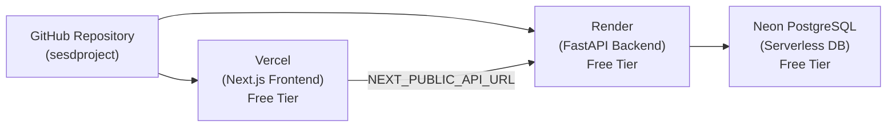

# LinkFlow ⚡ — Modern Scalable URL Shortener Platform

LinkFlow is a high-performance, full-stack URL shortening and analytics platform inspired by Bitly. Built with **FastAPI**, **Neon Lakebase PostgreSQL**, and **Next.js 14 (App Router)**.

---

## 🌟 Features

- **High-Performance Redirection**: Sub-millisecond redirects with 301 (Permanent) and 302 (Temporary) support.
- **Custom Aliases & Expiration**: Create branded short links with custom slugs and optional auto-expiration timestamps.
- **Rich Analytics & Telemetry**: 14-day aggregate click telemetry, daily breakdown, referrers, and browser/device metadata tracking.
- **Working Authentication Portal**: 
  - **Instant 1-Click Demo Login** pre-seeded with sample links and analytics.
  - User registration with instant auto-verification (when SMTP is not configured).
  - Secure JWT session cookie login, password recovery, and authenticated dashboard access.
- **Cloud Database Ready**: Native integration with Neon Lakebase Postgres (Serverless PostgreSQL).
- **Graceful Cache-Aside Architecture**: Optional Redis caching with seamless fallback to Postgres.
- **One-Click Local Launcher**: Single `server.bat` script launches both backend and frontend automatically.

---

## 🔑 Demo Account Credentials

A pre-verified demo user with sample short links and click telemetry is pre-seeded in the database:

| Field | Value |
|---|---|
| **Email** | `demo@linkflow.local` |
| **Password** | `Demo12345!` |

> 💡 **Tip**: On the Login page (`/login`), simply click the **"Demo Login"** button for instant one-click access!

---

## 🏗️ Project Structure

```
SESD-project/
├── backend/                    # FastAPI Backend Application
│   ├── app/
│   │   ├── api/                # API Endpoints (v1: auth, urls, analytics)
│   │   ├── core/               # Configuration, security (bcrypt/JWT), Redis client
│   │   ├── database/           # SQLAlchemy session, engine & auto-seeder
│   │   ├── models/             # ORM models (User, URL, ClickEvent, etc.)
│   │   ├── schemas/            # Pydantic request/response schemas
│   │   └── services/           # Business logic (URL hashing, analytics, email)
│   ├── migrations/             # Alembic database migrations
│   ├── tests/                  # Pytest test suite (25/25 passing)
│   ├── Dockerfile              # Container definition for cloud deployment
│   ├── Procfile                # Web process launcher for Render / Railway
│   ├── requirements.txt        # Python backend dependencies
│   └── .env.example            # Backend environment template
│
├── frontend/                   # Next.js 14 Frontend Application
│   ├── app/                    # Next.js App Router pages
│   │   ├── (auth)/             # Login, signup, verify-email, reset-password
│   │   ├── dashboard/          # Overview, My Links, Create, Analytics, Profile
│   │   ├── globals.css         # Tailwind dark theme styles
│   │   └── page.tsx            # High-conversion landing page
│   ├── components/             # Reusable UI components (Navbar, Footer, etc.)
│   ├── context/                # AuthContext & session management
│   ├── lib/                    # API client (lib/api.ts) and utilities
│   ├── package.json            # Frontend npm configuration
│   ├── vercel.json             # Vercel deployment configuration
│   └── .env.example            # Frontend environment template
│
├── render.yaml                 # Render Blueprint for 1-click backend deployment
├── server.bat                  # One-click Windows development launcher
├── .env.example                # Unified environment variables template
├── .gitignore                  # Git ignore rules (secrets, DBs, caches)
├── neon.ts                     # Neon cloud configuration
└── package.json                # Root package configuration
```

---

## 🚀 Quick Start (Local Windows)

The easiest way to start both servers is using the provided `server.bat` launcher:

1. **Clone the repository**:
   ```bash
   git clone https://github.com/2403a51274-code/sesdproject.git
   cd sesdproject
   ```

2. **Set up your environment variables**:
   ```bash
   copy .env.example .env.local
   copy backend\.env.example backend\.env.local
   copy frontend\.env.example frontend\.env.local
   ```
   *Fill in your database credentials in `.env.local`.*

3. **Double-click `server.bat`** (or run `.\server.bat` in terminal).
   - Validates Python virtual environment & dependencies.
   - Applies pending Alembic database migrations.
   - Starts FastAPI backend at `http://localhost:8000`.
   - Starts Next.js frontend at `http://localhost:3000`.
   - Automatically opens your default web browser to the app.

---

## ☁️ 100% Free Cloud Deployment Guide

This project is architected for zero-cost hosting using industry standard free tiers:



### Step 1: Database (Neon PostgreSQL) — Free Forever
*(Already configured if using the repository's `.env.local`)*
1. Go to [neon.tech](https://neon.tech) and create a free account.
2. Create a project (e.g. `linkflow-db`).
3. Copy the **Connection String** (`DATABASE_URL`).

---

### Step 2: Backend (Render) — 100% Free Web Service
1. Sign up for free at [render.com](https://render.com).
2. Click **New +** → **Web Service**.
3. Connect your GitHub repository: `2403a51274-code/sesdproject`.
4. Configure the service:
   - **Name**: `linkflow-api`
   - **Root Directory**: `backend`
   - **Runtime**: `Python 3`
   - **Build Command**: `pip install -r requirements.txt && alembic upgrade head`
   - **Start Command**: `uvicorn app.main:app --host 0.0.0.0 --port $PORT`
   - **Instance Type**: `Free`
5. In **Environment Variables**, add:
   - `DATABASE_URL`: *(Your pooled Neon connection string)*
   - `DATABASE_URL_UNPOOLED`: *(Your direct Neon connection string)*
   - `JWT_SECRET_KEY`: *(Generate any 64-char random string)*
   - `ENVIRONMENT`: `production`
   - `REDIS_ENABLED`: `false`
   - `FRONTEND_URL`: `https://your-frontend.vercel.app` *(update after Step 3)*
6. Click **Deploy Web Service**.
7. Note down your backend URL (e.g. `https://linkflow-api.onrender.com`).

---

### Step 3: Frontend (Vercel) — 100% Free Hobby Plan
1. Sign up for free at [vercel.com](https://vercel.com).
2. Click **Add New...** → **Project**.
3. Import your GitHub repository: `2403a51274-code/sesdproject`.
4. Configure the project:
   - **Framework Preset**: `Next.js`
   - **Root Directory**: Click edit and select `frontend`
5. In **Environment Variables**, add:
   - `NEXT_PUBLIC_API_URL`: `https://linkflow-api.onrender.com` *(from Step 2)*
6. Click **Deploy**.
7. In ~60 seconds, your site is live with a free SSL domain (e.g. `https://sesdproject.vercel.app`)!

---

## 📡 Key API Endpoints

- **Web App**: `http://localhost:3000`
- **Interactive Swagger Docs**: `http://localhost:8000/docs`
- **Redoc Documentation**: `http://localhost:8000/redoc`
- **Health Check**: `http://localhost:8000/health`
- **URL Redirection**: `http://localhost:8000/r/{short_code}`

---

## 🔒 Security Best Practices

- All passwords hashed using `bcrypt` (12 rounds).
- Short codes generated using cryptographically secure random characters.
- SQL injection prevention via SQLAlchemy 2.0 ORM parameterization.
- HTTP-only and Secure JWT cookies with CSRF defense.
- Sensitive environment files (`.env*`, `*.db`) are strictly excluded via `.gitignore`.
